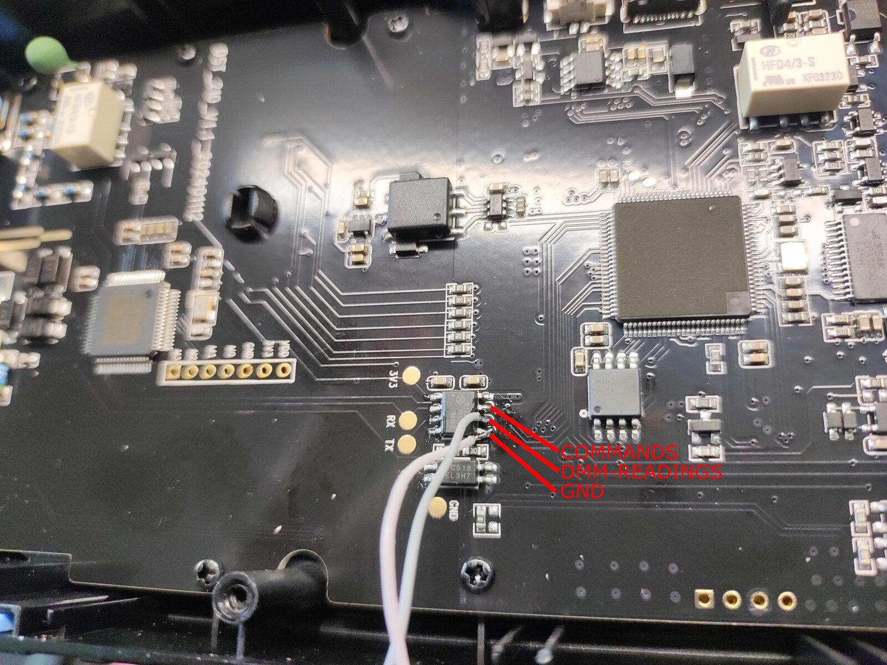

# FNIRSI DST-210: reading the multimeter over its internal UART

The FNIRSI DST-210 is a great multimeter for its price. It has relatively
high DMM precision, a simple DDS generator that is enough for simple cases,
and a simple DSO. The scope cannot replace a desktop one, but for simple
jobs it may fit, especially because the device is battery powered and
completely isolated from mains.

One flaw annoys me: there is no digital interface to collect readings. The
USB Type-C port does have a data function, but it seems to work only as a
USB mass storage device: downloading screenshots, uploading a boot logo,
and possibly firmware updates. It does not stream measurements.

This project reverse-engineers the DMM's internal data stream so that
readings can be logged on a computer. The goal is **read-only**: get
readings and log them. Switching modes stays manual on the meter. (If you
need a fully remote-controlled DMM, buy one; I already have one.)

## Hardware: the isolation barrier

Inside, the device is split into two galvanically isolated parts:

- **Multimeter side**: the measurement front end and its controller.
- **Display side**: display MCU, LCD, oscilloscope, generator, battery and
  the USB Type-C port (charging and mass storage).

The barrier between them consists of:

- an isolated DC-DC converter (power for the multimeter side),
- a **2Pai Semi π122U31** digital isolator,
- an **EL3H7** optocoupler.

Probing the signals going through the barrier showed a plain UART in both
directions: the multimeter side continuously sends its readings to the
display MCU, and the display MCU sends a short command to select the
measurement mode. Both can be tapped and decoded.



The tap is soldered to the display-side pins of the π122U31 (the SOIC-8
next to the big LQFP100 display MCU):

- **COMMANDS**: display -> multimeter (mode commands, `AA 55 ...`),
- **DMM-READINGS**: multimeter -> display (readings, `5A A5 ...`),
- **GND**: display-side ground.

The gold test points labelled RX, TX, GND and 3V3 to the left of the
isolator are on the **multimeter side**; see the warning below.

> **TODO:** logic level.

### Safety

The multimeter side floats at the potential of the measurement inputs.
**Only tap the UART on the display side of the isolator** (the side of
the π122U31 that faces the display MCU). Tapping on the multimeter side
connects your computer to the probe inputs.

> **WARNING:** the test points on the PCB marked **RX, TX, GND and 3V3**
> are on the **multimeter side** of the isolation barrier. If you connect
> your UART adapter there, **do not connect the multimeter to mains** (or
> any other hazardous voltage) unless your UART link is isolated (isolated
> USB-UART adapter, USB isolator, or a wireless link). Otherwise mains
> potential from the probes ends up on your computer, and possibly on you.

Note also that the display side shares ground with the scope and the
generator. Once a USB-UART adapter (or the meter's own USB port) connects
it to a PC, the scope and generator are no longer floating: their ground
is the PC ground. Use a USB isolator, or a wireless link, if you want to
keep the scope floating.

## Protocol summary

Full details, raw captures and open questions:
[dst-210-proto.md](dst-210-proto.md).

- UART **9600 baud**, 8N1.
- **Multimeter -> display** (readings): continuous stream, fixed
  **12-byte** packets, header `5A A5`, **no checksum**.
- **Display -> multimeter** (mode select): **10-byte** packets, header
  `AA 55`, with checksum. See [Mode commands](#mode-commands).

### Readings

```
5A A5 | d0 d1 d2 d3 d4 | f7 f8 f9 f10 | x11
hdr   | LCD segments    | flags        | unknown analog value
```

Example: `5A A5 86 FF 0B 4A 0E 00 02 00 01 1B` = **3.014 V DC**

#### Digits

The reading is not a binary number. It is the raw 7-segment bitmap of the
4.5-digit LCD: an optional minus sign, a half digit ("1" or blank), and
four full digits.

Each full digit spans two bytes: the **high nibble of byte k-1** and the
**low nibble of byte k** (bytes 2..6):

| Nibble | bit3 | bit2 | bit1 | bit0 |
|---|---|---|---|---|
| high | a | f | e | decimal point before this digit (minus sign for D1) |
| low  | b | g | c | d |

```
  aaa
 f   b
  ggg
 e   c
  ddd
```

Other display bits: byte 2 bit3 = leading "1", byte 8 bit7 = decimal point
after the leading "1".

#### Flags

| Bit | Meaning |
|---|---|
| byte 2 bit1 | DC |
| byte 2 bit0 | AC |
| byte 2 bit2 | auto-range (likely) |
| byte 7 bit3 | meter's auto (function auto-detect) mode |
| byte 6 bit7 | diode |
| byte 7 bit2 | M prefix |
| byte 6 bit6 | k prefix |
| byte 7 bit0 | m prefix |
| byte 6 bit4 | u prefix |
| byte 6 bit5 | n prefix |
| byte 8 bit1 | V |
| byte 8 bit0 | A |
| byte 7 bit5 | Ohm |
| byte 7 bit4 | F |
| byte 8 bit2 | Hz |
| byte 8 bit5 | temperature (always deg C) |

### Mode commands

```
AA 55 | 05 | mode | 00 00 00 00 00 | sum
hdr   | ?  |      | always 0       | sum of bytes 2..8, mod 256
```

Example: `AA 55 05 0C 00 00 00 00 00 11` = select **DC V**.

| Code | Mode | Code | Mode |
|---|---|---|---|
| `0A` | Capacitance | `11` | DC mA |
| `0B` | Resistance | `12` | Temperature |
| `0C` | DC V | `13` | Live-wire detection |
| `0D` | AC V | `14` | Auto mode |
| `0E` | Diode | `15` | AC A (10 A) |
| `0F` | Frequency | `16` | AC mA |
| `10` | DC A (10 A) | `17` | Continuity |

### Things to know

- **`OL`** is sent as segment glyphs (` .0L `). In live-wire mode the
  meter shows `OL` (no live wire found) or `LIvE` (live wire found), with
  no unit flags set.
- **deg F, HOLD, REL, MAX/MIN** are done entirely by the display MCU. They
  do not change the UART stream: it always carries live, absolute readings
  in deg C.
- **Byte 11** is not a checksum or range code. It looks like a slow analog
  value, and you don't need it to decode readings.

## Tools

[`dst210_read.py`](dst210_read.py) reads the stream from a USB-UART
adapter, decodes each packet and shows bits that are not yet identified.
It also marks which unknown bits changed since the previous packet, which
is handy for further reverse engineering.

[`dst210_read10.py`](dst210_read10.py) does the same for the other
direction (display -> multimeter mode commands): it checks the checksum,
names the mode and flags anything unexpected (unknown mode codes,
non-zero spare bytes).

```
pip install pyserial
python3 dst210_read.py /dev/ttyUSB0     # readings decoder
python3 dst210_read10.py /dev/ttyUSB1   # mode commands decoder
```

```
5A A5 8E EA B7 CD 07 01 01 00 01 20 |   176.25 |   176.25 mA   | DC AUTO?     | B7:00----0- B8:-0-00--- B9:00000000 B10:00000001 B11:00100000
5A A5 84 EA 4B AE 4D 20 80 00 01 27 |    .7042 |   0.7042 kOhm | AUTO?        | B7:00----0- B8:-0-00--- B9:00000000 B10:00000001 B11:00100111
```

## Story

I have reverse-engineered protocols of other multimeters before, and it
usually takes a while. This time Claude helped me, and the protocol was
decoded in about half an hour: I captured packets and noted what the
meter showed, and we worked out the segment layout and flags together.
